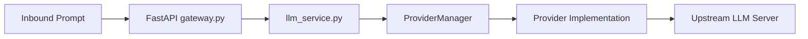

# LLM Gateway - Multi-Provider Routing & Pricing

This document details the proxy routing layers that direct incoming prompts to Gemini, OpenAI, DeepSeek, and Groq models.

---

## 1. Unified Router Architecture
When a developer sends a request to `POST /api/gateway/chat`, the request is processed through a unified middleware sequence:

By querying the gateway, downstream applications use a single standardized API request format instead of handling multiple target client SDKs.

---

## 2. Supported Providers & Dynamic Discovery

Downstream clients discover which providers and models are active by calling `GET /api/providers/models`:
* **Google Gemini**:
  * `gemini-2.5-flash`
  * `gemini-2.5-pro`
  * `gemini-2.0-flash`
  * `gemini-2.0-flash-lite-001`
  * `gemini-1.5-pro`
* **OpenAI**:
  * `gpt-4o`
  * `gpt-4o-mini`
  * `o1-mini`
* **DeepSeek**:
  * `deepseek-chat`
  * `deepseek-reasoner`
* **Groq** (high-speed inference):
  * `llama-3.1-8b-instant`
  * `llama-3.3-70b-versatile`
  * `llama-3.1-70b-versatile`

---

## 3. Centralized Pricing System (`app/providers/pricing.py`)
Token consumption costs are computed dynamically based on input/output pricing coefficients:
* Cost calculation formula:
  $$\text{Cost} = (\text{Prompt Tokens} \times \text{Input Price Rate}) + (\text{Completion Tokens} \times \text{Output Price Rate})$$
* These coefficients are decoupled from providers to simplify billing logic updates.

---

## 4. Offline Mock Testing Simulation
If a provider key configuration in `.env` is set to `"mock"` (e.g. `DEEPSEEK_API_KEY=mock`), the gateway generates a local simulated completion response. This allows testing frontend interfaces, database telemetry logging, and spend totals for free without hitting API limits.
