# LLM Gateway Platform - Phase 1 Complete Overview

This document provides a comprehensive technical overview of the **LLM Gateway Platform** built during Phase 1. It details the architecture, directory structure, libraries, security mechanisms, and files.

---

## 1. System Architecture


Below is the execution flow showing how an incoming API client request is routed, authorized, timed, and logged:

```mermaid
sequenceDiagram
    autonumber
    actor Client as API Client / Developer
    participant GW as FastAPI Gateway (app/main.py)
    participant SEC as Security Dependency (app/api/gateway.py)
    participant LLM as LLM Service (app/services/llm_service.py)
    participant GEM as Gemini Provider (app/providers/gemini.py)
    participant DB as PostgreSQL Database
    participant API as Upstream Gemini API

    Client->>GW: POST /api/gateway/chat with Bearer Key (gw_live_...)
    activate GW
    GW->>SEC: Validate Bearer Key (get_api_key_context)
    activate SEC
    SEC->>SEC: Compute SHA-256 of Key
    SEC->>DB: Query api_keys where hashed_key = SHA-256(key)
    DB-->>SEC: Return API Key & Owner User details
    SEC->>SEC: Validate key active states & expiry
    SEC-->>GW: Return Authorized User Context
    deactivate SEC

    GW->>LLM: route_request(db, user, request_data, client_ip)
    activate LLM
    LLM->>LLM: Record Start Time (time.perf_counter)
    LLM->>GEM: generate_chat(model, prompt, temp, max_tokens, api_key)
    activate GEM
    GEM->>API: Async HTTPS POST /v1/models/...
    API-->>GEM: Return Chat Generation + Token Metadata
    GEM-->>LLM: Return Text + Token Counts
    deactivate GEM

    LLM->>LLM: Record End Time & Compute Latency (Latency = End - Start)
    LLM->>LLM: Calculate USD Cost based on Token counts & pricing coefficients
    LLM->>DB: Log Usage statistics to usage_logs
    DB-->>LLM: Confirm Log Inserted
    LLM-->>GW: Return Formatted Response
    deactivate LLM
    GW-->>Client: 200 OK + ChatResponse (Text, Cost, Latency)
    deactivate GW
```



---

## 2. Directory Structure

```text
llm-gateway/
│
├── alembic/                      # Database migrations folder (created by Alembic)
│   ├── versions/                 # Folder holding individual migration scripts
│   │   └── 3700d5a88a3d_*.py     # The initial migration generated automatically
│   ├── env.py                    # Configures Alembic migration run connection (Async)
│   └── script.py.mako            # Mako template used to generate new migration scripts
│
├── app/                          # Main Application Directory
│   ├── api/                      # Routing layer (interfaces with requests)
│   │   ├── api_keys.py           # Keys CRUD API endpoints
│   │   ├── auth.py               # Registration, Login, Token Refresh API endpoints
│   │   ├── gateway.py            # Gateway Chat Proxy API endpoint
│   │   └── usage.py              # Metrics Dashboard API endpoint
│   │
│   ├── core/                     # Foundational project configurations
│   │   ├── config.py             # Environmental settings loading (Pydantic Settings)
│   │   ├── database.py           # Async SQLAlchemy connection and get_db session provider
│   │   └── security.py           # Password hashing & JWT helpers (Bcrypt, PyJWT)
│   │
│   ├── models/                   # Database definition schema mapping (SQLAlchemy ORM)
│   │   ├── api_key.py            # APIKey DB table structure
│   │   ├── refresh_token.py      # RefreshToken DB table structure
│   │   ├── usage.py              # UsageLog DB table structure
│   │   └── user.py               # User DB table structure
│   │
│   ├── schemas/                  # Request/Response Validation contracts (Pydantic models)
│   │   ├── api_key.py            # Pydantic schemas for API key payloads
│   │   ├── auth.py               # Pydantic schemas for Auth & Token payloads
│   │   ├── gateway.py            # Pydantic schemas for Chat prompts & responses
│   │   └── usage.py              # Pydantic schemas for dashboard data
│   │
│   ├── services/                 # Business logic implementation
│   │   ├── api_key_service.py    # Logic to create, hash, validate, and revoke keys
│   │   ├── auth_service.py       # Logic to register, login, and refresh tokens
│   │   ├── llm_service.py        # Gateway routing, pricing calculation, timing
│   │   └── usage_service.py      # Log writing and aggregate calculations
│   │
│   ├── providers/                # Raw client API bindings
│   │   ├── base.py               # Generic abstract class/interface for LLM providers
│   │   └── gemini.py             # Implementation of Google GenAI SDK wrapper
│   │
│   └── main.py                   # Root FastAPI app instantiator & router aggregator
│
├── phases/                       # Project phase documentation directory
│   └── phase_1.md                # Complete documentation of Phase 1 architecture & files
│
├── .env                          # Current local configuration (database connection, API keys)
├── .env.example                  # Template configuration file for development setups
├── alembic.ini                   # Alembic configuration configuration parameters
├── requirements.txt              # Project dependency package definitions
├── test_gemini.py                # Diagnostic connectivity script
└── test_models.py                # Diagnostics script testing model availability
```

---

## 3. Libraries Used & Their Technical Workings

Our Phase 1 implementation uses specific python packages to guarantee type-safety, performance, and security.

### A. Web Framework & Server
1. **`fastapi`**: An asynchronous, high-performance web framework.
   * *Working:* It parses incoming HTTP payloads, maps requests to async route handlers using Pydantic schemas, and handles dependency injection (via `Depends`) to manage database sessions and credential checking.
2. **`uvicorn[standard]`**: An ASGI (Asynchronous Server Gateway Interface) web server.
   * *Working:* Serves as the raw web server. It handles concurrent incoming sockets, schedules coroutines to the asyncio event loop, and translates HTTP requests into ASGI specifications for FastAPI.

### B. Database & ORM
3. **`sqlalchemy[asyncio]`**: The SQL Toolkit and Object Relational Mapper.
   * *Working:* We use SQLAlchemy 2.0's async extensions. It lets us write python classes (models) that map directly to PostgreSQL tables. Queries are declared programmatically (e.g. `select(User)`) and executed asynchronously over the non-blocking event loop.
4. **`asyncpg`**: A fast, asynchronous database driver for PostgreSQL.
   * *Working:* It is the engine connector that establishes the raw socket connections to PostgreSQL. It is built to work natively with python's `asyncio` to execute query transactions concurrently.
5. **`alembic`**: Database migration tool.
   * *Working:* It tracks your SQLAlchemy models. When you modify a model, Alembic checks the database schema, compares it to the code metadata, generates a versioned migration file, and executes the SQL scripts to keep the database state updated.

### C. Security & Hashing
6. **`pydantic-settings`**: Configuration management.
   * *Working:* Automatically reads, parses, and validates variables from your `.env` file into a type-safe settings class, guaranteeing the API crashes immediately on boot if any required environment parameter is missing or has a type mismatch.
7. **`bcrypt`**: Native cryptographic password hashing.
   * *Working:* Directly compiles C-level hashing scripts to apply `bcrypt` salt and key derivation factors. Unlike old libraries (`passlib`), this is modern and completely compatible with **Python 3.13**.
8. **`python-jose[cryptography]`**: JavaScript Object Signing and Encryption.
   * *Working:* Handles generation and validation of standard JWT (JSON Web Tokens). It takes user profile claims (claims payload), signs it with your `JWT_SECRET_KEY` using HMAC-SHA256, and decodes/validates signatures on inbound requests.
9. **`email-validator`**: Pydantic dependency.
   * *Working:* Validates that registered strings look like valid internet email addresses, preventing typos and syntax errors before they hit database constraints.

### D. AI Client
10. **`google-genai`**: The official, modern Google Gemini API SDK.
    * *Working:* Instantiates HTTP clients to interact with Gemini API. We utilize the `aio` extension (e.g. `client.aio.models.generate_content`) to perform fully asynchronous, non-blocking requests to Gemini models, keeping the gateway responsive under high loads.

---

## 4. Technical Specifications of Core Mechanisms

### A. Secure API Key Mechanics
API keys are used by developer applications to hit the gateway. Since they need to be validated on every request, we need a fast verification method that is secure against database leaks.

* **Format:** `gw_live_<48_hex_entropy_characters>` (created using `secrets.token_hex(24)`).
* **Storage:** We do **not** store the raw key.
  1. We extract the prefix: `gw_live_a1b2` (the first 12 characters). This is stored in the database as `key_prefix` so users can identify which key is which in a dashboard UI.
  2. We compute a cryptographic SHA-256 hash of the entire key: `hashlib.sha256(raw_key.encode()).hexdigest()`. We store this hash in the database.
* **Lookup (O(1)):** When a request arrives with `Authorization: Bearer gw_live_...`:
  1. The gateway hashes the incoming raw key using SHA-256.
  2. It queries the database: `SELECT * FROM api_keys WHERE hashed_key = :hashed_key`. Because the `hashed_key` column is indexed via a B-Tree index, database retrieval runs in **O(1) logarithmic time**, making lookups extremely fast.
* **Security:** If the database leaks, an attacker only sees SHA-256 hashes. Because of SHA-256's one-way property, they cannot reverse the hashes to reconstruct the original `gw_live_...` keys.

### B. JWT & Refresh Token Rotation
We implement a secure, standard 2-token authentication flow for our dashboard users:
1. **Access Token:** Short-lived JWT (15 minutes). It is stateless and decrypted on the fly by the server, minimizing database hits on user dashboard queries.
2. **Refresh Token:** Long-lived random hex string (7 days). Its hash is stored in the database linked to the user.
3. **Token Rotation:** When the access token expires:
   - The client calls `POST /api/auth/refresh` sending the `refresh_token`.
   - The server hashes it, matches it in the DB, verifies its expiration, deletes it (revokes it), and generates a **brand new** access token and a **brand new** refresh token.
   - This prevents replay attacks: if a refresh token is stolen, it will fail the next time it is reused because the server rotates it instantly on execution.

### C. Observability & Cost Calculations
Every single model transaction (successful or failed) is intercepted, timed, and logged:
* **Cost Tracking:** Pricing values (input/output rates per token) are defined in `MODEL_PRICING` (e.g. `gemini-2.5-flash` at `$0.075 / 1M` input tokens, `$0.30 / 1M` output tokens).
* **Execution:**
  1. We record the startup time using `time.perf_counter()`.
  2. We run the async call. If it throws an exception (like quota errors or service unavailable), we catch it.
  3. We calculate `latency_ms = int((time.perf_counter() - start_time) * 1000)`.
  4. If successful, we save the log with `status_code = 200`, prompt/completion token count, and computed cost.
  5. If it failed, we save the log with `status_code = 502/503`, token counts = 0, cost = 0, and write the error text inside `error_message`.
  6. We then throw the gateway error to the user. This ensures developers can debug their failed requests directly in their gateway logs dashboard!

---

## 5. Detailed Breakdown of Files

### app/core/ (Foundation Setup)
* **`config.py`**: Declares settings schemas. Uses `pydantic-settings` to load values like `DATABASE_URL` and `GEMINI_API_KEY`.
* **`database.py`**: Initializes the async engine (`create_async_engine`) and configures `async_sessionmaker`. Declares the declarative class `Base` that database classes inherit from.
* **`security.py`**: Holds bcrypt password utility functions (`verify_password`, `get_password_hash`) and JWT methods (`create_access_token`, `decode_access_token`).

### app/models/ (SQLAlchemy Definitions)
* **`user.py`**: Holds user attributes (`email`, `hashed_password`, `role`, `is_active`, `created_at`, `updated_at`). Relates users to refresh tokens, API keys, and logs.
* **`refresh_token.py`**: Database table schema mapping access tokens refreshes.
* **`api_key.py`**: Maps database entries for gateway credentials.
* **`usage.py`**: Schema for logging requests. Maps provider, model, tokens, USD cost, latency, status codes, and error strings.

### app/schemas/ (Pydantic Structures)
* **`auth.py`**: Serializes registration payloads, login forms, token returns, and decoding targets.
* **`api_key.py`**: Manages validation for key creation requests.
* **`gateway.py`**: Structure definitions for inbound prompts (`message`, `provider`, `model`) and outbound proxy returns.
* **`usage.py`**: Serializes logs output and formats user cumulative totals dashboard responses.

### app/services/ (Business Logic)
* **`auth_service.py`**: Integrates user registrations (hashes passwords) and login verifications. Implements the token refresh rotations.
* **`api_key_service.py`**: Generates high-entropy keys, hashes them, performs active validations, and handles CRUD operations for user keys.
* **`llm_service.py`**: The gateway routing center. Selects the provider wrapper, times execution latency, computes estimated costs, and coordinates with `UsageService`.
* **`usage_service.py`**: Persists log entities to PostgreSQL and calculates user aggregate summaries.

### app/providers/ (Client Bindings)
* **`base.py`**: Interface blueprint enforcing structured outputs from child providers.
* **`gemini.py`**: Implements communication with Gemini API, extracts token usage data from response metadata, and handles fallback logic if metadata is missing.

### app/api/ (Routing endpoints)
* **`auth.py`**: Maps `/api/auth/register`, `/login`, `/refresh`, and `/me`. Declares the JWT auth injector dependency `get_current_user`.
* **`api_keys.py`**: Maps key management endpoints (`GET`, `POST`, `DELETE`).
* **`gateway.py`**: Maps `/api/gateway/chat`. Declares custom key validator dependency `get_api_key_context`.
* **`usage.py`**: Maps `/api/usage` to return metrics logs.

### Root Files
* **`main.py`**: Binds the FastAPI application instance. Appends routers, adds CORS middleware, and configures a default Uvicorn startup on port `9000`.
* **`requirements.txt`**: Declares package versions.
* **`alembic.ini`** & **`alembic/env.py`**: Handles database migration connections.
