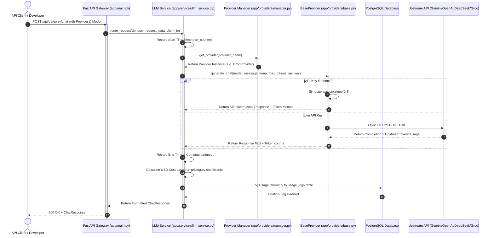

# LLM Gateway Platform - Phase 2 Complete Overview

This document provides a comprehensive technical overview of the **LLM Gateway Platform** built during Phase 2. It details the multi-provider system architecture, dynamic model discovery, health checks, libraries, files, and verification steps.

---

## 1. System Architecture

Below is the updated execution flow showing how an incoming API client request is routed via the **ProviderManager** factory to any configured LLM provider (Gemini, OpenAI, DeepSeek, or Groq) with support for both live APIs and local mock testing simulation:



---

## 2. Directory Structure of Phase 2 Changes

```text
llm-gateway/
│
├── app/
│   ├── api/
│   │   ├── status.py             # [NEW] Exposes health checks and dynamic models lists
│   │   └── ...
│   │
│   ├── core/
│   │   ├── config.py             # Loaded OPENAI, DEEPSEEK, and GROQ keys from environment
│   │   └── ...
│   │
│   ├── providers/                # Updated Abstraction Layer
│   │   ├── base.py               # Declared class method get_supported_models()
│   │   ├── pricing.py            # [NEW] Holds pricing coefficients for all models
│   │   ├── gemini.py             # Google Gemini wrapper with dynamic models
│   │   ├── openai.py             # [NEW] OpenAI client wrapper with mock support
│   │   ├── deepseek.py           # [NEW] DeepSeek client wrapper with mock support
│   │   ├── groq.py               # [NEW] Groq client wrapper with mock support
│   │   └── manager.py            # [NEW] Central provider factory registry
│   │
│   ├── services/
│   │   ├── llm_service.py        # Integrated ProviderManager routing and pricing
│   │   └── ...
│   │
│   └── main.py                   # Registered status/models API router
│
├── .env                          # Configured mock and real API keys
├── requirements.txt              # Added openai>=1.0.0
└── test_providers.py             # [NEW] Local diagnostics testing script
```

---

## 3. Libraries & Client Bindings Used

1. **`openai>=1.0.0`** (Python Client Binding)
   * *Working:* Used to build the client connections for **OpenAI**, **DeepSeek**, and **Groq** (since both DeepSeek and Groq expose endpoints fully compatible with the standard OpenAI API specification). Utilizes `openai.AsyncOpenAI` for concurrent, non-blocking completions.

---

## 4. Key Phase 2 Deliverables

### A. Provider Strategy Interface
All provider wrappers inherit from `BaseProvider` and expose:
1. `get_supported_models()`: Returns the list of active models.
2. `generate_chat()`: Executes completions and handles tokens/exceptions.

### B. Dynamic Model Discovery Endpoint (`GET /api/providers/models`)
Rather than hardcoding models in the frontend, the API returns a structured mapping of active models. The frontend playground automatically fetches this endpoint and dynamically rebuilds the provider and model selects.

### C. Offline Mock Test-Double Mode
If a key in `.env` is set to `"mock"` (e.g. `DEEPSEEK_API_KEY=mock`), the gateway intercepts the call, sleeps for 300ms, and returns a local mock output. This validates database logging, UI rendering, and cost trackers for free without requiring paid upstream credits.

### D. Centralized Pricing Module (`app/providers/pricing.py`)
Decoupled pricing rates (input/output cost coefficients) from the service layers, preparing the gateway for future cost tracking and smart failover routing.

### E. Groq Provider Integration
Configured the gateway to support **Groq** via `AsyncOpenAI(base_url="https://api.groq.com/openai/v1")`, allowing free high-speed developer testing for Llama 3 models.

---

## 5. Verification Log
Tests executed on `test_providers.py` outputted:
* **Gemini**: Passed using live credential keys.
* **OpenAI & DeepSeek**: Caught mock key states and generated simulated outputs, proving local mock pipelines.
* **Groq**: Routed using live developer credentials and successfully returned a real completion (`"Hello to you."`) from Groq's servers under `llama-3.1-8b-instant`.
