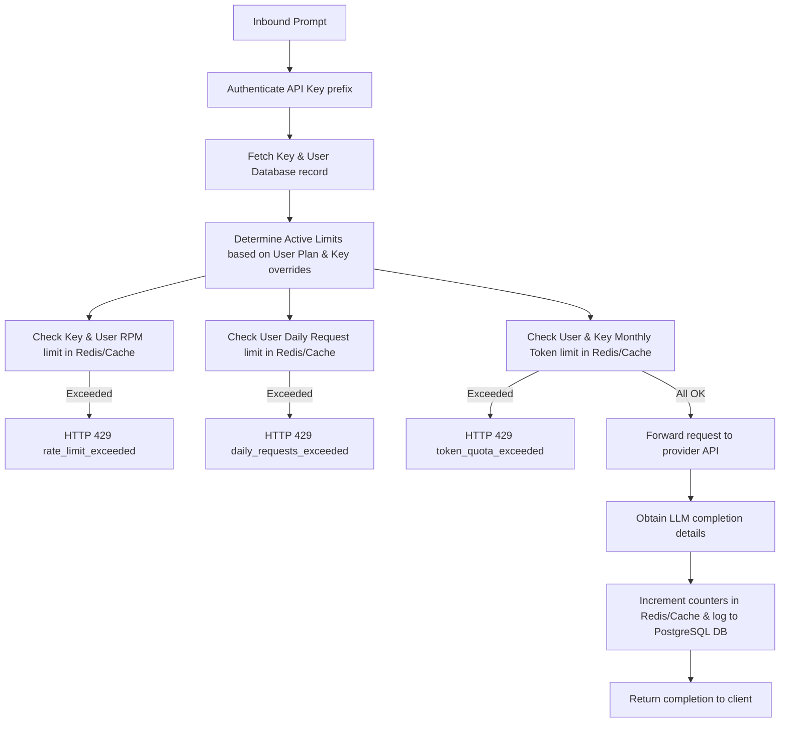

# LLM Gateway Platform - Phase 4 Design Specification

This document provides a comprehensive technical overview and specification of **Phase 4: Rate Limiting, Quotas & Plans** for the LLM Gateway Platform.

---

## 1. Objectives

1. **Implement Plan-Based Tiers**: Introduce `free`, `pro`, and `enterprise` limits defining RPM, daily requests, and monthly tokens.
2. **Fast Usage Tracking with Redis**: Ensure high-performance check capabilities for inbound request surges and monthly token depletion.
3. **API Key Limits & Overrides**: Enable administrators or developers to enforce specialized overrides on individual keys.
4. **Structured Error Handling**: Block quota/rate hits immediately using HTTP 429 exceptions with structured JSON error details.
5. **Real-Time Quota Dashboard**: Display usage warning states dynamically in the UI dashboard using progress indicators.

---

## 2. Limits Specification

| Plan | Daily Request Cap | Monthly Token Quota | Rate Limit (RPM) |
| :--- | :--- | :--- | :--- |
| **Free** | 100 | 100,000 | 60 |
| **Pro** | 1,000 | 1,000,000 | 300 |
| **Enterprise** | Unlimited (99,999,999) | Unlimited (99,999,999) | 1,000 |

*If custom limits (`rate_limit_rpm` or `monthly_token_quota`) are defined on the specific API Key, they override the plan-wide defaults.*

---

## 3. Directory Structure of Phase 4 Changes

```text
llm-gateway/
│
├── alembic/
│   └── versions/
│       └── c0a37e5b729f_add_limits_and_plans.py       # [NEW] Migration script to update DB schemas
│
├── app/
│   ├── api/
│   │   ├── auth.py                                   # Added PATCH /api/auth/upgrade endpoint
│   │   └── usage.py                                  # Added GET /api/usage/quota endpoint
│   │
│   ├── core/
│   │   └── config.py                                 # Added Redis URLs & PLANS definitions
│   │
│   ├── models/
│   │   ├── user.py                                   # Added plan_type to User model
│   │   └── api_key.py                                # Added override limits to APIKey model
│   │
│   ├── schemas/
│   │   ├── auth.py                                   # Added PlanUpgradeRequest schema
│   │   ├── api_key.py                                # Added limit overrides to APIKey response/create
│   │   └── usage.py                                  # Added QuotaUsageResponse schema
│   │
│   ├── services/
│   │   ├── rate_limiter.py                           # [NEW] Implements Redis checking & MemoryStore fallback
│   │   └── llm_service.py                            # Intercepts route_request with limits enforcement
│   │
│   └── static/
│       ├── index.html                                # Added Quota Progress Bars and Plan Upgrade modal
│       └── app.js                                    # Interacts with /api/usage/quota and dynamically styles UI
│
└── tests/
    └── test_quotas_limits.py                         # [NEW] Automated tests for limits, overrides & plan upgrades
```

---

## 4. Redis Key Naming Strategy

* **User RPM Count**: `ratelimit:user:{user_id}:{minute}` (TTL: 60s)
* **Key RPM Override**: `ratelimit:key:{key_id}:{minute}` (TTL: 60s)
* **User Daily Requests**: `quota:user:requests:{user_id}:{day_str}` (TTL: 24h)
* **User Monthly Tokens**: `quota:user:tokens:{user_id}:{month_str}` (TTL: 30d)
* **Key Monthly Tokens Override**: `quota:key:tokens:{key_id}:{month_str}` (TTL: 30d)

---

## 5. Execution Pipeline



### Text Flowchart Representation
```text
                  [ Inbound Prompt ]
                          │
                          ▼
            [ Authenticate API Key Prefix ]
                          │
                          ▼
          [ Fetch Key & User Database Record ]
                          │
                          ▼
    [ Determine Active Limits (User Plan & Key Overrides) ]
                          │
                          ├──────────────────────────────────┐
                          ▼                                  ▼
             [ Check RPM Limit in Cache ]             (If Exceeded) ──> [ HTTP 429 rate_limit_exceeded ]
                          │
                          ├──────────────────────────────────┐
                          ▼                                  ▼
             [ Check Daily Request Limit ]            (If Exceeded) ──> [ HTTP 429 daily_requests_exceeded ]
                          │
                          ├──────────────────────────────────┐
                          ▼                                  ▼
             [ Check Monthly Token Limit ]            (If Exceeded) ──> [ HTTP 429 token_quota_exceeded ]
                          │
                          ▼ (All OK)
             [ Forward to Provider LLM API ]
                          │
                          ▼
             [ Obtain Completion Details ]
                          │
                          ▼
        [ Increment Cache Counters & Log to DB ]
                          │
                          ▼
             [ Return Response to Client ]
```

---


## 6. Core SaaS Features Built in Phase 4

### A. Thread-Safe MemoryStore Fallback
To ensure developers can run and test the gateway in local development environments without needing a live Redis server, the `RateLimiterService` contains an async-compatible in-memory fallback store (`MemoryStore`). It uses automatic prune-on-write functionality to clear expired entries and prevent memory leaks.

### B. User-Level Monthly & Daily Counters
To prevent users from circumventing plan limits by spinning up new API keys (a common SaaS exploit), monthly token usage and daily request usage are grouped and queried by **User ID** (`quota:user:*`). API Keys can still have individual overrides to impose tighter client constraints.

### C. Standardized HTTP 429 Responses
When a limit is reached, the Gateway responds with HTTP 429 and a structured body payload. This helps client SDKs parse errors cleanly:
```json
{
  "detail": {
    "error": {
      "code": "rate_limit_exceeded",
      "message": "Requests per minute limit exceeded. Please slow down."
    }
  }
}
```
Available codes: `rate_limit_exceeded`, `daily_requests_exceeded`, `token_quota_exceeded`.

### D. Real-Time UI Visual Alerts
The UI monitors daily request usage and monthly token usage. In accordance with professional styling guidelines, progress bars change colors automatically as limits are approached:
* **Green**: < 80% usage
* **Yellow**: 80% to 95% usage (warning status)
* **Red**: >= 95% usage (exhausted/near-exhausted status)

---

## 7. Verification Suite

### A. Run Database Migrations
To upgrade the database schema and add the plan and overrides fields, execute:
```bash
.\venv\Scripts\alembic.exe upgrade head
```

### B. Execute Automated Quota & Limits Test
Execute the automated test script to verify plan upgrading, RPM rate limits, token quotas, and API key level overrides:
```bash
.\venv\Scripts\python.exe -m tests.test_quotas_limits
```

### C. Manual Playground Verification
1. Open the UI at `http://127.0.0.1:9000/`.
2. Under the billing/settings tab, select a new plan (e.g. Upgrade to **Pro**) and verify that limits change.
3. Check the progress indicators to monitor usage in real-time.
